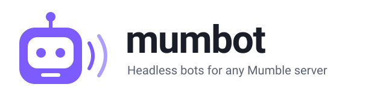
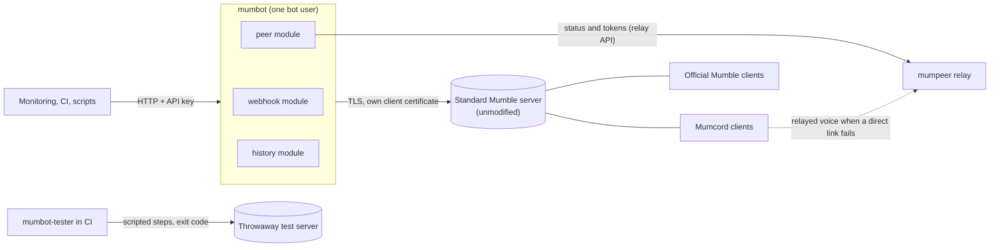

<p align="center">
  
</p>

<p align="center">
  <a href="https://github.com/Mumcord/mumbot/actions/workflows/ci.yml"></a>
  <a href="https://github.com/Mumcord/mumbot/releases"></a>
  <a href="LICENSE"></a>
  <a href="https://github.com/Mumcord/mumbot/pkgs/container/mumbot"></a>
  <a href="https://github.com/Mumcord/mumbot/pkgs/container/mumbot-tester"></a>
  <a href="Cargo.toml"></a>
</p>

<p align="center">
  <b>Bots that join your Mumble server like a person would: post alerts, announce a relay, drive tests.</b><br />
  <a href="#quick-start">Quick start</a> ·
  <a href="docs/README.md">Docs</a> ·
  <a href="examples/README.md">Examples</a> ·
  <a href="https://github.com/Mumcord/mumbot/releases">Releases</a> ·
  <a href="CHANGELOG.md">Changelog</a>
</p>

## What it is

mumbot is one small binary (or Docker image) with headless bots for
[Mumble](https://www.mumble.info/) voice chat. It is built from **modules**: run one, or several
together as one bot user on one connection. Every bot logs in with its own client certificate,
exactly like a person with a Mumble client, so it works with **any unmodified, standard Mumble
server**: no server plugin, no server config change, no protocol extension. Its messages look the
same in the official Mumble client and in [Mumcord](https://github.com/Mumcord/mumcord).

## Modules

| Module | What it does | Build | Docs |
| --- | --- | --- | --- |
| **`webhook`** | Monitoring, CI or any script sends one HTTP request with an API key; the bot posts it into a channel. | main + tester | [webhook.md](docs/webhook.md) |
| **`peer`** | Connects the server to a [mumpeer](https://github.com/Mumcord/mumpeer) relay: announces the relay to Mumcord clients and hands out short-lived relay tokens. | main + tester | [peer.md](docs/peer.md) |
| **Test bot** (`say`, `expect`, `play`, `script`, …) | A scripted second participant for automated tests: chat, user state, admin steps, checks, voice play/record/level. Exit code 0 = passed. | tester only | [cli.md](docs/cli.md) |
| **Load test** | Fills a local test server with up to 1000 users, with churn, chat and talkers. | tester, from source | [cli.md](docs/cli.md#load-test) |
| Music | Plays an MP3 (or a URL) sent over HTTP as voice into a channel. | planned | [#3](https://github.com/Mumcord/mumbot/issues/3) |
| **`history`** | Stays online, records the chat of the channels you choose and hands it to Mumcord clients that were offline (history sync). | main + tester | [history.md](docs/history.md) |

> [!NOTE]
> The `peer` module, `mumbot run` and the separate tester build are on `main` and ship with the
> next release. Release 0.1.1 has the webhook bot and the test bot in one build.

## How it fits together



- The bot is a normal user on the server. Chat goes in as ordinary channel messages; the `peer`
  module talks to Mumcord clients with plugin data, which official Mumble clients ignore.
- The bot itself never relays voice. mumpeer does that, and only for Mumcord clients that ask for it.
- The tester build belongs in CI, next to a throwaway server, never on a production server.

## Quick start

### Main build, Docker

Post a message into your Mumble server in 30 seconds:

```bash
KEY=$(openssl rand -hex 32)
cat > bot.toml <<EOF
[server]
host = "mumble.example.org"      # your server
channel = "Lobby"

[http]
listen = "0.0.0.0:8080"

[[keys]]
key = "$KEY"
label = "quickstart"
channels = ["Lobby"]
EOF
chmod 644 bot.toml

docker run -d --name mumbot -p 127.0.0.1:8080:8080 \
  -v "$PWD/bot.toml:/config/bot.toml:ro" -v mumbot-data:/data \
  ghcr.io/mumcord/mumbot:0.1.1
```

```bash
curl -s -H "X-API-Key: $KEY" http://127.0.0.1:8080/channels          # find the channel id
curl -s -X POST http://127.0.0.1:8080/message -H "X-API-Key: $KEY" \
  -d '{"channel": 1, "message": "**deploy** finished"}'
# {"delivered":true}
```

No server at hand? [`examples/webhook-with-server`](examples/webhook-with-server/) starts a
standard Mumble server next to the bot with one `docker compose up`.

### Main build, binary

```bash
curl -LO https://github.com/Mumcord/mumbot/releases/download/v0.1.1/mumbot-0.1.1-linux-x86_64.tar.gz
curl -LO https://github.com/Mumcord/mumbot/releases/download/v0.1.1/SHA256SUMS
sha256sum -c SHA256SUMS --ignore-missing && tar xzf mumbot-0.1.1-linux-x86_64.tar.gz
./mumbot webhook --config bot.toml
```

Each archive holds `mumbot` (`mumbot.exe` on Windows) at the top level, next to the licence, this
README, the changelog and `bot.example.toml`.

### Tester build, for CI

A throwaway Mumble server plus the scripted test bot, one command per test step:

```bash
cd examples/ci-test-bot
printf 'SUPERUSER_PASSWORD=%s\n' "$(openssl rand -hex 16)" > .env
docker compose up -d --wait mumble-server

# Is the client under test in Root and unmuted? Exit code 0 = yes.
docker compose run --rm -T bot --name Observer --timeout 20 expect user MyClient --in Root --muted false

# Several steps on one connection, one per line.
printf '%s\n' 'say "<b>hello</b>"' 'expect message --from MyClient --contains hi' 'sleep 1' \
  | docker compose run --rm -T bot --name Bob script

docker compose --profile bot down -v
```

Ready to copy: [`smoke-test.sh`](examples/ci-test-bot/smoke-test.sh) and a
[GitHub Actions workflow](examples/ci-test-bot/github-actions.yml). Only point the test bot at
local or throwaway servers.

## Running several modules

```bash
mumbot webhook --config bot.toml                          # one module
mumbot peer --config bot.toml
mumbot history --config bot.toml
mumbot run --config bot.toml --modules webhook,peer,history # several, one connection, one bot user
MUMBOT_MODULES=webhook,peer,history mumbot run --config bot.toml  # same, handy in Docker
```

Or list them in `bot.toml` and run `mumbot run --config bot.toml`:

```toml
[modules]
enabled = ["webhook", "peer", "history"]
```

The command line wins over the config. Only the sections of the chosen modules are checked, and
when one module fails the whole bot stops. Details: [docs/modules.md](docs/modules.md).

## Configuration

One TOML file (`bot.toml`, in Docker `/config/bot.toml`) with a section per concern:

| Section | For |
| --- | --- |
| `[server]` | The Mumble server, channel, the bot's name and data folder, `server_cert_sha256`. |
| `[modules]` | Which modules `mumbot run` starts (optional). |
| `[http]`, `[[keys]]` | The webhook module's listener and its API keys. |
| `[[token]]` | Channel passwords (optional). |
| `[peer]` | The mumpeer relay for the peer module. |
| `[history]` | Channels to record, retention and database for the history module. |
| `[voice]` | Voice bitrate (`bitrate`, `--bitrate`, `MUMBOT_VOICE_BITRATE`). |

Secrets such as `SERVER_PASSWORD` and `MUMBOT_PEER_API_SECRET` come from the environment. Every
key, default and variable: [docs/configuration.md](docs/configuration.md); a commented start:
[`examples/bot.example.toml`](examples/bot.example.toml).

| Docs | |
| --- | --- |
| [Modules and builds](docs/modules.md) | Run one module or several; the two builds. |
| [Webhook bot](docs/webhook.md) · [HTTP API](docs/http-api.md) | Endpoints, authentication, message format. |
| [Peer bot](docs/peer.md) | Announce a mumpeer relay to Mumcord clients. |
| [History bot](docs/history.md) | Record channel chat for Mumcord clients that were offline. |
| [CLI](docs/cli.md) | Every command and flag, test-bot scripts, voice checks, load test. |
| [Security](docs/security.md) | API keys, the client certificate, TLS, server certificate checking. |

## Security and privacy

**All modules**
- Always TLS to the server, with the bot's own client certificate. That certificate is the bot's
  identity: keep the data folder (`/data` in Docker) on a persistent volume, back it up, never share it.
- Logs hold request metadata only: no API keys, no passwords, no message texts.
- The Docker image runs as a non-root user (uid 10001).

**Webhook**
- Plain HTTP on `127.0.0.1:8080` by default; put a TLS reverse proxy in front to reach it from
  other machines.
- One long random API key per caller, limited to its channels and rate-limited; keys are compared
  in constant time.
- Caller text is escaped: only a small Markdown subset and `http`/`https` links get through, never HTML.
- It does not check the server certificate yet: run it on the same host or a trusted network as the server.

**Peer**
- Requires a pinned server certificate (`server.server_cert_sha256`) and refuses any other server.
- The relay's API secret (32+ characters) lives in a private file or `MUMBOT_PEER_API_SECRET`,
  never in `bot.toml` or Git.
- Hands out short-lived relay tokens only; it never sees or relays voice.

**History**
- Records only the channels you list, never private messages, and keeps messages at most 7 days.
- The SQLite file is readable only by the bot's user; chat texts never go into logs.

**Test bot (tester build)**
- Only for local or throwaway test servers. Generate the SuperUser password per CI run and remove
  the server with its volumes afterwards.

More: [docs/security.md](docs/security.md).

## Examples

| Example | Use it to |
| --- | --- |
| [`webhook/`](examples/webhook/) | Run the webhook bot against the Mumble server you already have. |
| [`webhook-with-server/`](examples/webhook-with-server/) | Try everything on one machine: bot plus a standard Mumble server. |
| [`peer-with-relay/`](examples/peer-with-relay/) | Try the peer bot with a mumpeer relay and a standard Mumble server. |
| [`history/`](examples/history/) | Run the history bot against the Mumble server you already have. |
| [`ci-test-bot/`](examples/ci-test-bot/) | Test a Mumble client in CI against a throwaway server (tester image). |

## Releases and variants

Every release ships two variants. Both binaries are called `mumbot`; only the archive and image
names differ. Check downloads against `SHA256SUMS` from the same release.

| | **mumbot** (main) | **mumbot-tester** |
| --- | --- | --- |
| Contains | The production modules (`webhook`, `peer`, `history`). No test code. | The same plus the scripted test bot (checks, voice, samples). |
| Use it for | Bots on real servers. | Testing Mumble servers and clients in CI. |
| Docker image | `ghcr.io/mumcord/mumbot:<version>` | `ghcr.io/mumcord/mumbot-tester:<version>` |
| Linux x86_64 (static) | `mumbot-<version>-linux-x86_64.tar.gz` | `mumbot-tester-<version>-linux-x86_64.tar.gz` |
| Linux arm64 (static) | `mumbot-<version>-linux-aarch64.tar.gz` | `mumbot-tester-<version>-linux-aarch64.tar.gz` |
| Windows x86_64 | `mumbot-<version>-windows-x86_64.zip` | `mumbot-tester-<version>-windows-x86_64.zip` |
| macOS (Apple Silicon and Intel) | `mumbot-<version>-macos-universal.tar.gz` | `mumbot-tester-<version>-macos-universal.tar.gz` |

- Images are multi-arch (`linux/amd64`, `linux/arm64`), non-root, with a health check on
  `/health`. Stable releases also get `latest`; pin a version tag.
- The main build answers a test command with a pointer to the tester build (exit code 2).
- The tester variant starts with the next release (see the note under [Modules](#modules)).

From source (Rust 1.90+):

```bash
cargo build --release                     # mumbot
cargo build --release --features tester   # mumbot-tester, also needs CMake (builds Opus)
```

## Part of the Mumcord family

| | |
| --- | --- |
| [Mumcord](https://github.com/Mumcord/mumcord) | A modern desktop voice and chat client for standard Mumble servers. |
| [mumpeer](https://github.com/Mumcord/mumpeer) | A relay that connects Mumcord clients when a direct link fails. |
| **mumbot** | Friendly headless bots: webhooks, relay discovery, test automation. |

mumbot is built on Mumcord's protocol and codec crates
([`mumcord-protocol`](https://crates.io/crates/mumcord-protocol),
[`mumcord-codec`](https://crates.io/crates/mumcord-codec)), and Mumcord's end-to-end tests use its
test bot. You do not need Mumcord: the bots work with any standard Mumble server.

## Contributing

Issues and pull requests are welcome.

```bash
cargo fmt --check
cargo clippy --all-targets -- -D warnings && cargo test                                    # main build
cargo clippy --all-targets --features tester -- -D warnings && cargo test --features tester  # tester build
cp testenv/.env.example testenv/.env && testenv/up.sh     # local test server (Docker)
MUMBOT_LIVE=1 cargo test --features tester -- --ignored --test-threads=1     # live tests against it
```

- Features start as a spec in [`specs/`](specs/); the [roadmap](specs/roadmap.md) lists what comes
  next.
- Small commits in [Conventional Commits](https://www.conventionalcommits.org/) style, user-visible
  changes in [`CHANGELOG.md`](CHANGELOG.md).
- Never test against public or third-party Mumble servers; use [`testenv/`](testenv/README.md).

## Licence

[AGPL-3.0-only](LICENSE)
