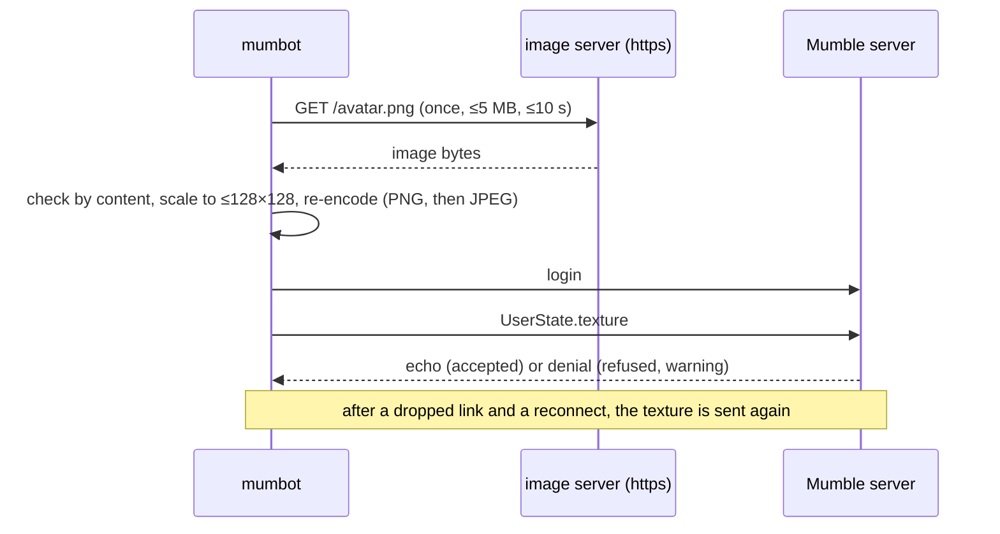

# Epic 6 – Avatar · Specification

> Status: Final (decisions taken in the issue) · As of: 2026-11-04
> Sources: Mumcord issue [#460](https://github.com/Mumcord/mumcord/issues/460) (mumbot: avatar from config, image URL or base64), decisions of 2026-11-04
> Builds on: `specs/03-modules-specification.md` (modules share one connection, one login and one reconnect loop); related Mumcord issues #458 (bots are shown separately, where the avatar appears) and #459 (Mumbot version label)

## 1. Goal & context

A Mumbot bot is an ordinary Mumble client, so it looks like a plain user: without a picture, a bot
that posts messages or plays music is hard to recognise in a busy channel. Mumble already has a
standard way to show a person's picture — the user texture (`UserState.texture`) — and every client
renders it. So the bot only needs a way to be given an image: the `[bot]` section of the config, as
an image URL or as base64.

The bot sends that image as its own texture after every login. Mumcord shows it in "Bots on this
server" (#458) and in the channel tree for voice bots, the official Mumble client shows it like any
avatar, and nothing is needed on the server side.

## 2. Scope

### 2.1 In scope

- Config section `[bot]` with `avatar_url` (https only) or `avatar_base64`, and the environment
  variables `MUMBOT_AVATAR_URL` / `MUMBOT_AVATAR_BASE64`.
- The image is read once at startup, checked by content, scaled to at most 128×128 pixels and
  re-encoded so it fits the server's image limit.
- The result is sent as `UserState.texture` right after the login and again after every reconnect.
- Fallback: any problem is one warning with the reason, and the bot runs without an avatar.
- Documentation (`docs/configuration.md`, `examples/bot.example.toml`), unit tests and one live test
  against `testenv/`.

### 2.2 Out of scope / later

- A local file path as an image source (issue decision: URL or base64 only for now).
- Refetching the image while running, or retrying a failed download later: restart only (issue
  decision), like the module list and every other config value.
- Host allowlists, IP restrictions or TLS pinning for the download. The config file is the
  operator's own decision (see `specs/05-music-specification.md`, where URL sources are opt-in
  because they are called by outside systems; here nothing comes from outside).
- Animated GIF or WebP: only the first frame is used. No thumbnailing, no EXIF orientation, no
  format other than PNG, JPEG, GIF and WebP.
- A different avatar per module, per server or per channel; the test bot (`mumbot-tester`) keeps its
  own `avatar` command and reads no config file.
- Changing `imagemessagelength` on the server: not possible under the client-only rule, so the bot
  fits the limit it is given.

## 3. Roles & permissions

| Role | What it can do | Who checks it |
| --- | --- | --- |
| Operator (owns `bot.toml`) | choose the image source, or none | nobody; the config file is the operator's decision |
| Mumble server | accept or refuse the texture, cap it by `imagemessagelength` | murmur's standard rules; the bot only fits the announced limit |
| Any client | see the bot's avatar like any user's avatar | nothing to check: `UserState.texture` is standard protocol |

No API key, no permission on the server, no server change. A bot that is not allowed to change its
own user state gets a denial, which is reported as a warning.

## 4. Functional requirements

### 4.1 Config and source

- **FR-6.1** Optional section `[bot]` with `avatar_url` or `avatar_base64`. Unknown keys are errors,
  as everywhere in the config. Setting both stops the start with an error.
- **FR-6.2** `MUMBOT_AVATAR_URL` and `MUMBOT_AVATAR_BASE64` follow the existing pattern: they win
  over the file, an empty value counts as unset, and one source from the environment plus one from
  the file are still both, i.e. a config error.
- **FR-6.3** Nothing set: no avatar and nothing logged.

### 4.2 Reading the image

- **FR-6.4** A URL is fetched once at startup with one plain GET: https only (plain http is refused,
  and so is a redirect to it), at most 5 MB, at most 10 s for the whole download including the
  redirects (at most 5 hops), `Connection: close`, no chunked answers, no user info in the URL.
- **FR-6.5** Base64 is decoded and then treated exactly like a downloaded image.
- **FR-6.6** The image must decode as PNG, JPEG, GIF or WebP by content, not by file name or
  `Content-Type`. Its dimensions are refused before decoding: at most 4000 pixels per edge and at
  most 100 MB of decoder memory (decompression-bomb guard).
- **FR-6.7** The image is always re-encoded, never passed through: scaled down to at most 128×128
  (small images keep their size, nothing is enlarged), written as PNG; if that is larger than the
  server's limit, JPEG at falling quality (85, 70, 50). The limit is the server's announced
  `imagemessagelength`; when the server sends 0 or nothing, 128 KiB is used.
- **FR-6.8** The bytes are sent as the bot's texture right after the login and again after every
  reconnect, because a reconnect is a new session.

### 4.3 Fallback

- **FR-6.9** A problem — bad URL, failed download, timeout, answer that is not 200, content that is
  not one of the four formats, an image that cannot fit the limit — is reported as one warning with
  the reason, the bot connects without an avatar and keeps running. No image data is logged, only the
  reason and counts.
- **FR-6.10** A refusal by the server is reported too: within the delivery window
  (`http.delivery_timeout_secs`, default 3 s) a denial for the bot's own session is logged as a
  warning with the server's reason. Nothing is waited for beyond that window, so a problem with the
  avatar never delays a message.
- **FR-6.11** An avatar problem never stops the bot and never fails a reconnect.

## 5. Interfaces

Config, commented as in `examples/bot.example.toml`:

```toml
[bot]
# Either a URL (https only) ...
avatar_url = "https://example.org/night-owls-relay.png"
# ... or the image inline as base64 (PNG, JPEG, GIF or WebP). Set only one of the two.
# avatar_base64 = "iVBORw0KGgoAAAANSUhEUgAA..."
```

Log lines (the only place the feature speaks):

```text
WARN avatar: invalid avatar URL: must be https, starting without it
WARN avatar: no answer within 10 s, starting without it
WARN avatar: not a PNG, JPEG, GIF or WebP image, starting without it
WARN avatar does not fit the server's image limit of 4096 bytes, connecting without it
WARN the server refused the avatar (TextTooLong), connecting without it
```

In Mumble nothing is added: the avatar is the standard user picture, shown by Mumcord and by the
official client.

## 6. Audio & network

No audio. One connection for the bot, one separate HTTPS connection for the single download at
startup (TLS with Mozilla's root store, the same stack as the music module's URL sources).



Protocol: `UserState` with `texture` only, no private extension. Standard servers 1.2+; the image
limit is the server's own setting, and a server that announces nothing gets murmur's default.

## 7. Data & state model

Nothing is stored. The decoded image lives in memory for the lifetime of the process (in practice a
few tens of kilobytes, worst case bounded by FR-6.6). No cache, no file, no personal data: the URL
itself can name a person, so it is logged only as the reason text, never downloaded again and never
written anywhere.

| Field | Where | Rules |
| --- | --- | --- |
| `avatar_url` / `avatar_base64` | config file, environment | operator's data, not logged |
| decoded image | process memory only | re-encoded per login, never kept on disk |

No states beyond the bot's normal connection states in `specs/03-modules-specification.md`.

## 8. Technology & architecture

- `src/avatar.rs`: the config section, source resolution, content check, scaling, re-encoding and the
  send; `src/avatar/fetch.rs`: the one-shot HTTPS GET. Kept apart from the bot core and from the HTTP
  API, so the protocol, the bot logic and the outside interface stay in separate modules.
- `image` 0.25 with only the four decoders and the PNG/JPEG encoders (no other formats, no default
  features), `base64` 0.23 — both already used by Mumcord for its own avatars, so the bot produces
  the same result as the client.
- The re-encoding runs at startup and after a login, on the async runtime; it is bounded by the caps
  above, so it never blocks the runtime longer than a fraction of a second.
- The bot core sends the texture through its existing `set_avatar`; nothing new is added to
  `mumcord-protocol`.

## 9. Non-functional requirements

- The download runs once, at startup, with a hard timeout and size cap; a slow or dead image server
  delays the start by at most 10 s and then produces one warning.
- Memory: bounded by the decode caps (FR-6.6), no per-message cost afterwards.
- Logging: warnings with the reason only; no image bytes, no full URL beyond the host, no personal
  data.
- The feature is optional and cheap: without `[bot]` the bot behaves exactly as before.
- Static builds: pure-Rust decoders only, so the musl binaries and the Alpine image need no system
  libraries.

## 10. Build, packaging & release

Nothing changes in the packaging: the same `mumbot` and `mumbot-tester` binaries and the same Docker
images, only two more libraries in the build (a small size increase). `RUST_LOG=warn` shows the avatar
warnings. No new setup step beyond putting the image URL or base64 in the config.

## 11. Acceptance criteria (verifiable in the running bot)

- **AC-6.1** Unit tests: a PNG is decoded by content and scaled to 128×128; a smaller image keeps its
  size; content that is not PNG, JPEG, GIF or WebP is refused; a header that declares more than 4000
  pixels is refused before decoding; a PNG that does not fit a small limit is re-encoded as JPEG at a
  falling quality, and an impossible limit produces no image.
- **AC-6.2** Unit tests: `https` only, `http` refused, user info refused, a redirect to `http` refused,
  `Content-Length` above the cap refused, chunked answers refused, `MUMBOT_AVATAR_URL` beats
  `avatar_url`, both sources are an error, an empty value counts as unset.
- **AC-6.3** Live test against `testenv/`: a bot with `avatar_base64` logs in, and a second client on
  the same server sees the bot's avatar equal to the re-encoded image.
- **AC-6.4** Live test: after a forced reconnect the observer sees the same avatar again.
- **AC-6.5** Live test: an invalid setting (base64 that cannot be decoded) produces the warning and the
  bot connects; the observer sees a bot without an avatar. The bot stays running.
- **AC-6.6** Live test against the local server with `imagemessagelength` at its default: the sent
  image never exceeds the announced limit, and the server accepts it.

## 12. Decision log

| Question | Decision | Note |
| --- | --- | --- |
| Image source | URL or base64, no local file path | issue decision of 2026-11-04 |
| Refetch or retry | only at startup / on restart | issue decision: keeps it simple, like the module list |
| Section name | `[bot]`, keys `avatar_url` / `avatar_base64` | as written in the issue; environment forms follow the existing pattern |
| Environment precedence | env wins over the file | as `MUMBOT_PEER_API_SECRET` does; empty counts as unset |
| Both set | config error at startup | issue decision |
| Format check | by content, four formats only | issue decision |
| Scaling | 128×128, never enlarge | what Mumble clients display |
| Encoding | always re-encoded: PNG, then JPEG 85/70/50 | same approach as Mumcord's `encode_avatar` |
| Server limit | `image_message_length`, else 128 KiB | issue decision; murmur's default |
| Redirects | followed, https only, at most 5 | the issue forbids redirects to http; a plain GET without redirects would break common CDN setups |
| Download guard | ≤5 MB, ≤10 s total, ≤4000 px, ≤100 MB decoder memory | issue gives the first two; the caps are the compression-bomb guard |
| Host allowlist | none | the config is the operator's own trusted input, unlike the music module's API |
| Rejection by the server | warning, within the delivery window | murmur does not acknowledge a texture, so a denial for the bot's own session is the only visible refusal |
| Animated images | first frame only | the texture is a still image in every client |

## 13. Open points & risks

- A server with a very small `imagemessagelength` can refuse every real photo; the bot reports it and
  runs without an avatar. Mumcord reduces the size further in that case; Mumbot stays at 128×128 as
  the issue describes. To be decided if operators hit this in practice.
- Fetching a URL from the bot's machine means the image server sees the bot's IP. Documented; nothing
  can be done about it on the client side.
- `image` adds two libraries to the release binaries; acceptable, and the same one Mumcord uses.

## 14. Impact on the roadmap

None for the big picture. The feature is not an epic of `specs/roadmap.md`; it is specified as Epic 6
so that the issue's requirements have a home in `specs/`. Mumcord needs no change (issue #458 is the
place where the avatar is shown).
